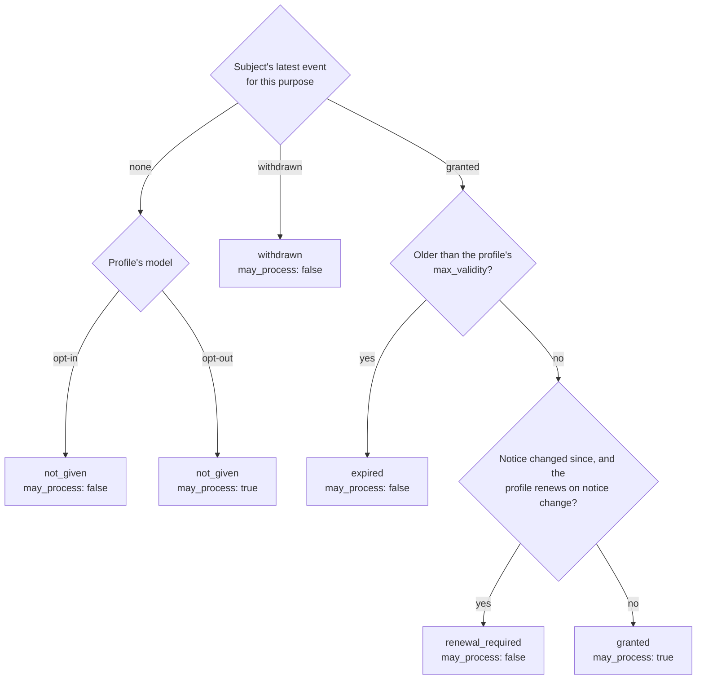
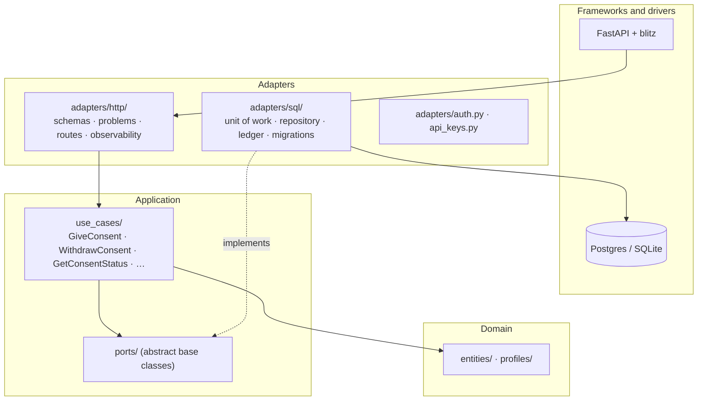

# Consent app example

A consent-management service on the blitz boilerplate. Client systems (a CRM, a web app, a
call-centre tool) record each subject's decision per processing purpose and ask, before
processing, whether they may. The rules come from a **regulation profile**: the core is
regulation-neutral, and GDPR is its first profile.

It is the lean sibling of [`examples/todo`](../todo): the same guarantees, built with only the
parts that consent needs (see [What carried over from the todo example](#what-carried-over-from-the-todo-example)).

> **A reference implementation, not legal advice and not a full privacy platform.** It covers
> recording and answering consent only. It does not cover:
> - data-subject requests (access, erasure);
> - the age of digital consent and parental consent (GDPR Art. 8);
> - purpose retirement;
> - per-client permissions (every client may call every endpoint).

## Run

The example is its own uv project, depending on blitz from this repository. From
`examples/consent/`:

```bash
make install                 # uv sync
make api-key CLIENT=crm      # prints a key (once) and the CONSENT_API_KEYS entry to add
export CONSENT_API_KEYS=crm=<sha256 printed above>
make dev                     # :8000, SQLite by default (CONSENT_DATABASE_URL for Postgres)
make verify                  # format, lint, mypy --strict, tests (the root `make verify` runs it too)
```

`make seed` loads demo data through the use cases:
- four purposes;
- 24 pseudonymous subjects whose decisions use varied methods and channels;
- withdrawals;
- a republished analytics notice, so some grants are `renewal_required`;
- one pre-ticked box, which GDPR refuses like a real one.

It prints the resulting states. The event IDs are fixed, so a re-run replays instead of
recording twice, and the data is the same on every machine. It refuses to run with
`ENVIRONMENT=production`.

```bash
KEY=csk_…   # the key make api-key printed
H=(-H "Authorization: Bearer $KEY" -H 'content-type: application/json')

curl "${H[@]}" -X POST localhost:8000/v1/purposes/ \
  -d '{"slug": "newsletter", "description": "Monthly newsletter", "notice_version": "2026-01"}'

curl "${H[@]}" -X POST localhost:8000/v1/subjects/subj-42/consents \
  -d '{"purpose": "newsletter", "notice_version": "2026-01", "method": "checkbox", "source": "web-signup"}'
# 201 {"event": {…, "recorded_by": "crm", "profile": "gdpr"}, "status": {"state": "granted", "may_process": true, …}}

curl "${H[@]}" localhost:8000/v1/subjects/subj-42/consents          # ask before processing
curl "${H[@]}" localhost:8000/v1/subjects/subj-42/history           # the evidence
```

| Endpoint | Does | Refusals |
| --- | --- | --- |
| `POST /v1/purposes/` | Declare a purpose and its notice | `409 purpose_exists` |
| `GET /v1/purposes/` | List purposes | |
| `POST /v1/purposes/{slug}/notices` | Publish a new notice version | `404`, `409 notice_unchanged` |
| `POST /v1/subjects/{id}/consents` | Record a grant | `404`, `409 notice_outdated`, `422 method_not_accepted` |
| `POST /v1/subjects/{id}/withdrawals` | Record a withdrawal (always accepted) | `404` |
| `GET /v1/subjects/{id}/consents[?purpose=]` | May we process? Per purpose | `404` |
| `GET /v1/subjects/{id}/history` | Every decision, oldest first | |

- **Authentication:** every `/v1` call needs `Authorization: Bearer <api key>`. The client's
  name is recorded on each event it writes.
- **Subject IDs** must be pseudonymous; email addresses are refused (`422`).
- **Safe retries:** both decision endpoints take an optional `event_id`. Retrying with the
  same ID records nothing new (`Idempotent-Replayed: true`); reusing it for a different
  decision is `409 event_id_reused`.

## How a decision is judged

The status is derived, never stored. It comes from the subject's latest event and the profile:



A grant is only recorded if the profile accepts its method and the subject saw the purpose's
current notice.

### Regulation profiles

`RegulationProfile` (`consent_app/profiles/regulation_profile.py`) is the rules as data. The
core never names a regulation:

| Field | GDPR (`profiles/gdpr.py`) |
| --- | --- |
| `model` | `opt_in`: consent is "a clear affirmative act" (Art. 4(11)) |
| `accepted_methods` | checkbox, toggle, signed form, recorded verbal, double opt-in. Not pre-ticked boxes, implied consent or inactivity (Recital 32) |
| `max_validity` | none: lasts until withdrawn (Art. 7(3)) |
| `renew_on_notice_change` | yes: consent must be informed (Art. 4(11), 7(2)) |

- **Withdrawal** has no method requirement and is always accepted: it must be as easy as
  giving consent (Art. 7(3)).
- **Choosing a profile:** a deployment picks one with `CONSENT_PROFILE`, and every event
  records which profile it was made under.
- **Adding a regulation** means adding a profile to `PROFILES`. The unit tests already exercise
  an opt-out profile and an expiring one to show the core needs no change.

## Architecture



```
consent_app/
├── entities/     subject_id · purpose_slug · notice_version · purpose · consent_event ·
│                 consent_method · consent_decision · consent_status        (stdlib only)
├── profiles/     regulation_profile (the rules as data) · gdpr
├── ports/        unit_of_work · purpose_repository · consent_ledger · clock · id_generator · errors
├── use_cases/    create_purpose · list_purposes · publish_notice · give_consent ·
│                 withdraw_consent · get_consent_status · get_consent_history · recording · errors
├── adapters/     http/ · sql/ (database, errors, tables, migrations/) · auth · api_keys · system
├── container.py  composition root (the only place naming concrete classes)
├── domain.py     blitz hooks (make_router, bootstrap) · factory.py · settings.py · main.py
consent_tests/    unit/ (fakes) · integration/ (contract, SQL, API) · architecture/ · fuzz/ · fakes/
```

## What carried over from the todo example

| Learning | Applied here |
| --- | --- |
| A change and its evidence must commit together | **The ledger is the evidence.** Each decision is one row in an append-only table, written in the use case's transaction, so no audit outbox is needed. The blitz audit event is a best-effort copy made after the commit; an audit outage is logged, never a failed request. |
| Evidence must not be rewritable | **Database triggers** reject `UPDATE` and `DELETE` on `consent_events` (SQLite and Postgres). A test proves raw SQL can't tamper with it. |
| Retries must not duplicate writes | **A natural idempotency key:** the client's `event_id` is the event's primary key. A lost race rolls back and replays the winner. No separate idempotency store. |
| Outages are not bugs | Driver errors are translated by SQLite result code or Postgres SQLSTATE. Use cases catch only `StorageUnavailableError`, and an unreachable database fails in under a second. |
| Fakes must not drift | Ports are abstract base classes. One in-memory fake implements them, and contract tests run it and SQL side by side. |
| Boundaries erode without checks | Tests enforce the dependency rule and check that every port has an adapter and a fake. |
| Schemas need versioning | Alembic, with a drift test and a downgrade/upgrade test. Startup refuses a stale schema when auto-migration is off. |
| Keep the overhead proportional | **Dropped**, because consent doesn't need them: the outbox relay, the idempotency store, telemetry ports, a CLI, a shared kernel and a multi-context layout. |

## Settings and monitoring

| Setting | Default | Meaning |
| --- | --- | --- |
| `CONSENT_PROFILE` | `gdpr` | The regulation profile for this deployment |
| `CONSENT_API_KEYS` | (empty: every call 401) | `client=sha256(key)`, comma-separated. Use `make api-key` |
| `CONSENT_DATABASE_URL` | `sqlite+aiosqlite:///consent.db` | SQLAlchemy URL (secret) |
| `CONSENT_DB_MIGRATE_ON_STARTUP` | `true` | Set `false` in production and run `make migrate` as a release step |
| `CONSENT_DB_CONNECT_TIMEOUT_SECONDS` | `5` | Postgres connect and pool-wait timeout |

| `CONSENT_METRICS_REFRESH_SECONDS` | `15` | How often business metrics are recomputed from the database |

**Dashboard:** [`grafana/consent-dashboard.json`](grafana/consent-dashboard.json). Run it with
[`../observability`](../observability): `make up`, `make seed`, `make consent`, then Grafana on
:3000. It shows:
- the requests the app served;
- where every subject stands per purpose (states and `may_process`, judged by the profile, so
  exactly what the API would answer);
- the ledger broken down by method, channel and decision;
- the records themselves: recent decisions, and purposes with their notice history.

**Metrics:**
- **Decisions and refusals:** `consentapp_decisions_total{decision, purpose, profile}` and
  `consentapp_refusals_total{code}` count requests as they're served.
- **Business gauges**, recomputed from the database by the `SummariseConsent` use case:
  - `consentapp_subjects{purpose, state}`;
  - `consentapp_subjects_may_process{purpose}`;
  - `consentapp_known_subjects`;
  - `consentapp_ledger_events{decision, method, source}`;
  - `consentapp_purpose_notice_info{purpose, notice_version}`.

  Because they're recomputed from storage, data written by any process (`make seed` too) shows up.

`/health` includes `consent_store`: whether the database is reachable, and which profile is in
force.

## Test

```bash
make verify          # or: uv run pytest
CONSENT_TEST_POSTGRES_URL=postgresql+asyncpg://user:pw@localhost:5432/consent_test make verify
```

The storage tests (contract, append-only, migrations) run on SQLite, and on Postgres when
`CONSENT_TEST_POSTGRES_URL` is set. CI sets it.
