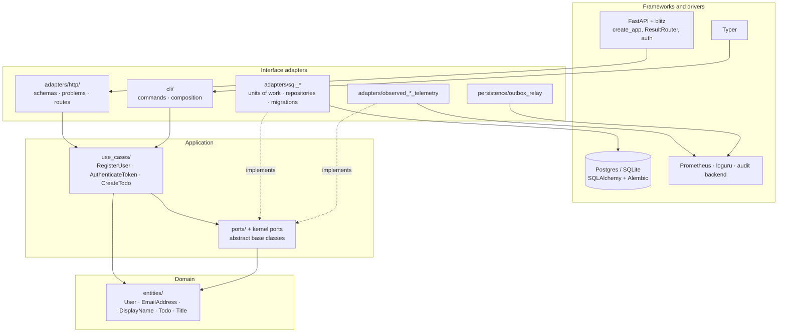
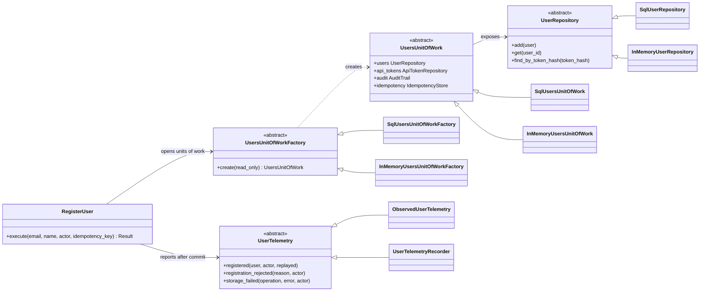
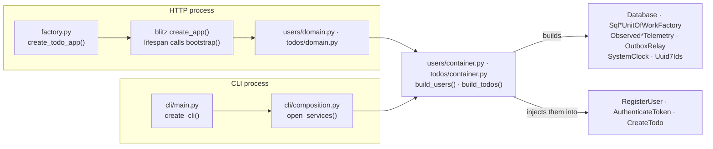
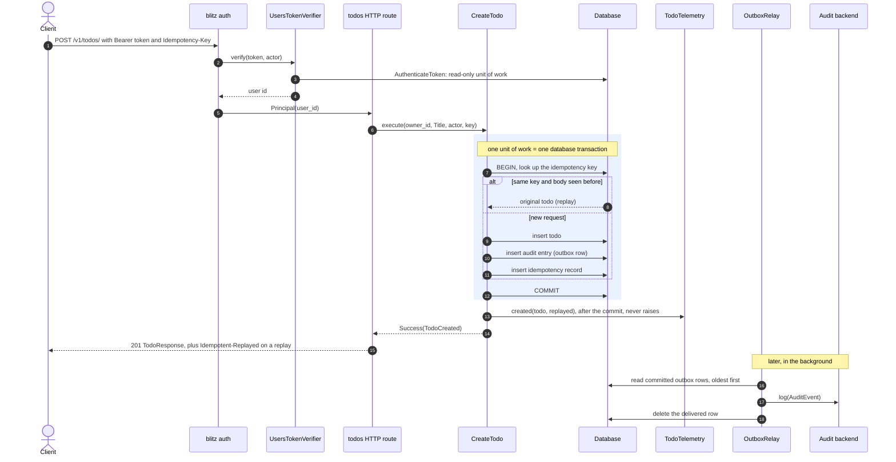

# Architecture

How `examples/todo` is built, and the rules that keep it that way. The decisions behind it
(unit of work, outbox, idempotency, error rules, persistence) are in
[design-decisions.md](design-decisions.md); running it is in [operations.md](operations.md).

## Layers



A solid arrow means *imports / calls*, and a dashed arrow means *subclasses the port*. Every
solid arrow between layers points inward, toward the domain. The use cases never import an
adapter. Instead the adapters implement the use cases' ports, and the composition root (below)
hands those implementations to the use cases. That is the dependency rule, and
`todo_tests/architecture/` fails the build if an import breaks it.

## Layout

Every layer is a package. Each module inside holds one concept and is named after it, and the
package's `__init__.py` exports the public names (`from todo_app.users.entities import User`).

```
examples/todo/
├── pyproject.toml                       # own project: blitz (by path) + typer, tool config
├── Makefile                             # install · dev · verify · fmt · test · coverage
├── .env.example
├── conftest.py                          # fixtures: app/client on a temp DB, audit_log, db, metric
├── todo_app/
│   ├── kernel/                          # shared kernel (stdlib only)
│   │   ├── actor.py                     # Actor: who called, which request
│   │   ├── audit.py                     # AuditRecord, AuditTrail port
│   │   ├── idempotency.py               # IdempotencyRecord, IdempotencyStore port, TTL
│   │   ├── errors.py                    # StorageUnavailableError
│   │   ├── clock.py                     # Clock port, SystemClock
│   │   └── ids.py                       # IdGenerator port, Uuid7Ids
│   ├── persistence/                     # shared SQL infrastructure (SQLAlchemy Core, async)
│   │   ├── database.py                  # Database: engine, transaction(), dialect setup
│   │   ├── errors.py                    # outage vs bug, by SQLite code / Postgres SQLSTATE
│   │   ├── tables.py  types.py          # outbox + idempotency table builders, UtcDateTime
│   │   ├── sql_audit_outbox.py          # AuditTrail inside the transaction
│   │   ├── sql_idempotency_store.py     # IdempotencyStore inside the transaction
│   │   ├── migrations.py                # upgrade(), ensure_at_head() via Alembic
│   │   └── outbox_relay.py              # delivers committed audit entries to the backend
│   ├── web/                             # shared HTTP helpers: request_actor, Idempotency-Key
│   ├── auth/
│   │   ├── principal.py                 # Principal
│   │   ├── token_verifier.py            # TokenVerifier port
│   │   ├── bearer_token_provider.py     # BearerTokenAuthProvider (blitz AuthProvider)
│   │   └── dependencies.py              # CurrentPrincipalDep
│   ├── settings.py                      # TodoSettings (TODO_*), handed to bootstraps
│   ├── factory.py                       # HTTP composition root: create_todo_app()
│   ├── main.py  __main__.py             # ASGI app / python -m todo_app
│   ├── cli/                             # command-line driver (Typer), no web imports
│   │   ├── main.py                      # create_cli(): Typer app, logging (audit always on)
│   │   ├── commands.py                  # args → value objects → use case → JSON + exit code
│   │   ├── composition.py               # open_services(): both containers, outbox drained on exit
│   │   └── exit_codes.py                # sysexits-style ExitCode
│   ├── users/
│   │   ├── entities/
│   │   │   ├── user.py                  # User
│   │   │   ├── email_address.py         # EmailAddress (normalising value object)
│   │   │   ├── display_name.py          # DisplayName
│   │   │   └── api_token.py             # generate / hash / pre-check API tokens
│   │   ├── ports/
│   │   │   ├── unit_of_work.py          # UsersUnitOfWork (+ factory): the atomic boundary
│   │   │   ├── user_repository.py       # UserRepository, EmailTakenError
│   │   │   ├── api_token_repository.py  # ApiTokenRepository
│   │   │   └── user_telemetry.py        # UserTelemetry: metrics/logs, must not raise
│   │   ├── use_cases/
│   │   │   ├── register_user.py         # RegisterUser, Registration (+ idempotent replay)
│   │   │   ├── authenticate_token.py    # AuthenticateToken
│   │   │   └── errors.py                # UserErrorCode, UserError (no HTTP status)
│   │   ├── adapters/
│   │   │   ├── http/
│   │   │   │   ├── schemas.py           # Pydantic request/response bodies
│   │   │   │   ├── problems.py          # UserProblem: error → HTTP status
│   │   │   │   └── routes.py            # POST /users/
│   │   │   ├── sql_tables.py                  # the context's tables (SQLAlchemy Core)
│   │   │   ├── sql_users_unit_of_work.py      # one database transaction
│   │   │   ├── sql_user_repository.py
│   │   │   ├── sql_api_token_repository.py
│   │   │   ├── sql_migrations.py              # upgrade() / ensure_at_head() for this context
│   │   │   ├── migrations/                    # Alembic env + versions, table alembic_version_users
│   │   │   ├── observed_user_telemetry.py     # Prometheus counters, logs
│   │   │   └── users_token_verifier.py        # AuthenticateToken → auth.TokenVerifier
│   │   ├── container.py                 # UsersDomain + build_users(): framework-free wiring
│   │   └── domain.py                    # blitz domain module: make_router(), bootstrap()
│   └── todos/                           # same shape: entities/{todo,title}.py,
│                                        # ports/{unit_of_work,todo_repository,todo_telemetry}.py,
│                                        # use_cases/{create_todo,errors}.py, adapters/...
└── todo_tests/
    ├── fakes/                           # transactional in-memory units of work, telemetry
    │                                    # recorders, FixedClock, SequentialIds, RecordingAuditBackend
    ├── fixture_types.py                 # types of the conftest fixtures
    ├── unit/                            # one file per use case / entity module, on fakes
    ├── integration/                     # Database, outbox relay, unit-of-work *contract* tests
    │                                    # (fakes, SQLite and Postgres alike), migrations, HTTP, audit, metrics, wiring
    ├── cli/                             # CLI commands, CLI+HTTP interop, runtime import proof
    ├── fuzz/                            # Hypothesis properties of value objects and tokens
    └── architecture/                    # the dependency rule, as a test
```

## Ports and adapters

Each port is an abstract base class owned by the application layer. Production adapters
(`Sql*`, `Observed*`) and test fakes (`InMemory*`, `*Recorder`) subclass it, so they can
be swapped without the use case noticing. The users context looks like this, and todos has the
same shape:



(The factory's `create` is its `__call__`: `async with factory() as uow:`.)

## Composition: two drivers, one wiring

The only code that names concrete classes is each context's `container.py`. The HTTP app and
the CLI are two thin composition roots on top of it, so both get identical use cases:



The HTTP process starts the outbox relay as a background task. The CLI doesn't poll; it drains
the outbox when each command closes.

## How a request flows

`POST /v1/todos/` with a bearer token and an `Idempotency-Key`:



1. **blitz auth**: `BearerTokenAuthProvider` asks its `TokenVerifier` port. The composition
   root plugged in the users context's `UsersTokenVerifier`, which runs `AuthenticateToken`.
   The route receives a `Principal(user_id)`.
2. **HTTP adapter** (`todos/adapters/http/routes.py`): Pydantic validates the body, delegating
   to the `Title` value object. The adapter builds an `Actor` (user, request ID, client, path)
   from blitz's request context and calls `CreateTodo.execute(owner_id, Title(...), actor,
   idempotency_key=...)`.
3. **Use case** (`todos/use_cases/create_todo.py`): opens one **unit of work**, which is a single
   database transaction. Inside it the use case:
   - looks up the idempotency key, and if it's a retry returns the original todo;
   - adds the todo;
   - records the audit entry in the **outbox**;
   - stores the idempotency record.

   Everything commits together or not at all. Only after the commit does it report to
   `TodoTelemetry`, which handles metrics and logs and never raises.
4. **Outbox relay** (`persistence/outbox_relay.py`): a background task delivers committed audit
   entries to blitz's audit backend, oldest first, and deletes each one only once the backend
   has accepted it.
5. **Back out**: the HTTP adapter maps `TodoCreated → TodoResponse` (setting
   `Idempotent-Replayed` on a replay) and `TodoError → TodoProblem`, and blitz's `ResultRouter`
   renders the result.

## Principles, and where each one lives

| Principle | In this code |
| --- | --- |
| Dependency rule | `entities/` imports only the stdlib and `kernel/`. `ports/` and `use_cases/` add `returns` and their own context's inner packages. Adapters import inward, never the reverse. |
| Entities hold business rules | `EmailAddress` normalises and validates itself, as do `DisplayName` and `Title`. An invalid `User` can't be constructed. |
| Use cases are application-specific rules | `RegisterUser`, `AuthenticateToken` and `CreateTodo` are plain classes with explicit dependencies. |
| Ports owned by the application | Every port is an abstract base class (`abc.ABC` + `@abstractmethod`). `ports/` defines the units of work, repositories and telemetry. `kernel/` defines `Clock`, `IdGenerator`, `AuditTrail` and `IdempotencyStore`, and `auth/` defines `TokenVerifier`. `EmailTakenError` is part of the port's contract, not SQLite's. |
| Adapters implement ports explicitly | Every adapter and every fake subclasses its port (`class SqlUserRepository(UserRepository)`), so an incomplete one fails on instantiation, and your editor can list each port's implementations. |
| Framework independence | No FastAPI, Pydantic, SQLite, Prometheus, loguru or blitz types in `entities/`, `ports/` or `use_cases/`. HTTP statuses live in `adapters/http/problems.py`. |
| Separate input/output models | Pydantic `RegisterUserBody` / `RegisteredUserResponse` exist only at the HTTP edge, so the API shape can change without touching entities. |
| Bounded contexts | `users` and `todos` never import each other, and todos keep the owner as a bare id with no foreign key. Only `factory.py` sees both. |
| Composition root | Each context's `container.py` is the only place it names concrete classes. `factory.py` (HTTP) and `cli/composition.py` (CLI) build both contexts from those containers. |
| Independent of delivery | The CLI drives the same use cases with no FastAPI in the process: `-X importtime` checks this at runtime, and the architecture test checks it statically. |
| Unit of work | `ports/unit_of_work.py` is the atomic boundary. A use case's writes, including its audit entry and idempotency record, commit together. |
| Explicit inputs | Use cases receive an `Actor` value, never blitz's `RequestContext`, so they run the same from HTTP, a CLI or a worker. |
| Testability | Use cases are tested against transactional in-memory fakes with a fixed clock and sequential IDs, with no I/O. Contract tests run the same checks against the fakes and SQLite. |

## Enforced, not hoped for

`todo_tests/architecture/test_dependency_rule.py` parses every import, including relative ones
resolved to full module names, and fails the build if any of these happen:
- an entity imports anything other than the stdlib (minus I/O and driver modules such as
  `sqlite3` and `asyncio`), `kernel/` or its own package;
- a port or use case reaches outside its context's `entities/`, `ports/` and `use_cases/`;
- one context imports the other;
- `auth/` imports a context.

`todo_tests/architecture/test_ports_and_adapters.py` discovers every port and fails if one isn't
an abstract base class, or if it lacks a concrete subclass in `todo_app` or a fake in
`todo_tests/fakes`. Use-case ports need a fake; `TokenVerifier` is exercised through HTTP only.

## Where this deviates from blitz's domain contract, and why

AGENTS.md describes a flatter layout (`models.py`, `service.py`, ...). This example keeps
blitz's *runtime* contract: each context's `domain.py` exposes `make_router()` and `bootstrap()`,
domains are looked up with `get_domain()`, `aclose()` releases resources, errors become RFC 9457
problems through `ResultRouter`, and state changes are audited. It changes four conventions so
the inner layers stay framework-free and side effects stay consistent:

- **Use cases take an `Actor`, not `ctx: RequestContext`.** `RequestContext` wraps the
  Starlette request. The HTTP adapter turns it into a plain `Actor` (`web/actor.py`).
- **Audit goes through an outbox, not `log_operation`.** Entries are written in the use case's
  transaction and delivered by `OutboxRelay`, so an audit outage can't fail or undo a change.
- **Use-case errors carry no HTTP status.** `UserProblem` / `TodoProblem` (subclasses of
  `DomainError`, in `adapters/http/problems.py`) add the status.
- **Entities are dataclasses, not Pydantic models.** Pydantic schemas are adapter code.

## Minimum viable layering

The full shape is the reference. A team that adopts the pattern
([ADR 0001](../../../docs/adr/0001-layered-high-integrity-pattern.md)) can start smaller and
grow, as long as each guarantee keeps what it depends on:

| Guarantee | Keep | Can wait |
| --- | --- | --- |
| Business rules can't be bypassed | Self-validating value objects; use cases take value objects, not raw input | One module per concept (`entities.py` per context is fine at first) |
| A change and its audit entry commit together | The unit-of-work port, its SQL adapter, the outbox table, the relay | A telemetry port (emit metrics from the HTTP adapter at first) |
| Retries don't duplicate writes | The idempotency table written inside the unit of work; `add` raising on a taken key | Token rotation on replay (only needed if a response carries a secret) |
| Outages aren't mistaken for bugs | `persistence/errors.py`; use cases catch only `StorageUnavailableError` | Per-operation storage metrics |
| The boundaries stay put | `todo_tests/architecture/` and the unit-of-work contract tests | A second driver (CLI), fuzz tests |

Copy `kernel/` and `persistence/` as they are. They are the parts that are easy to get subtly
wrong.
