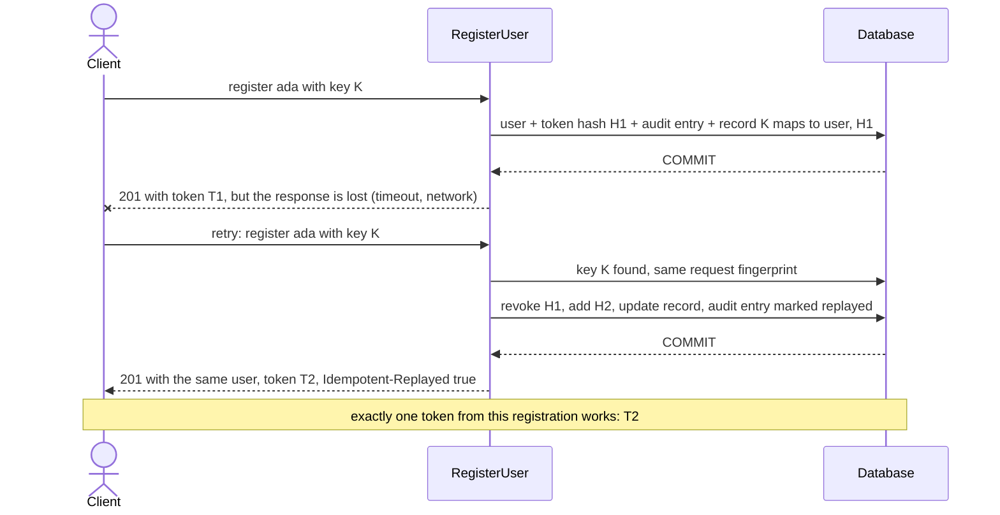
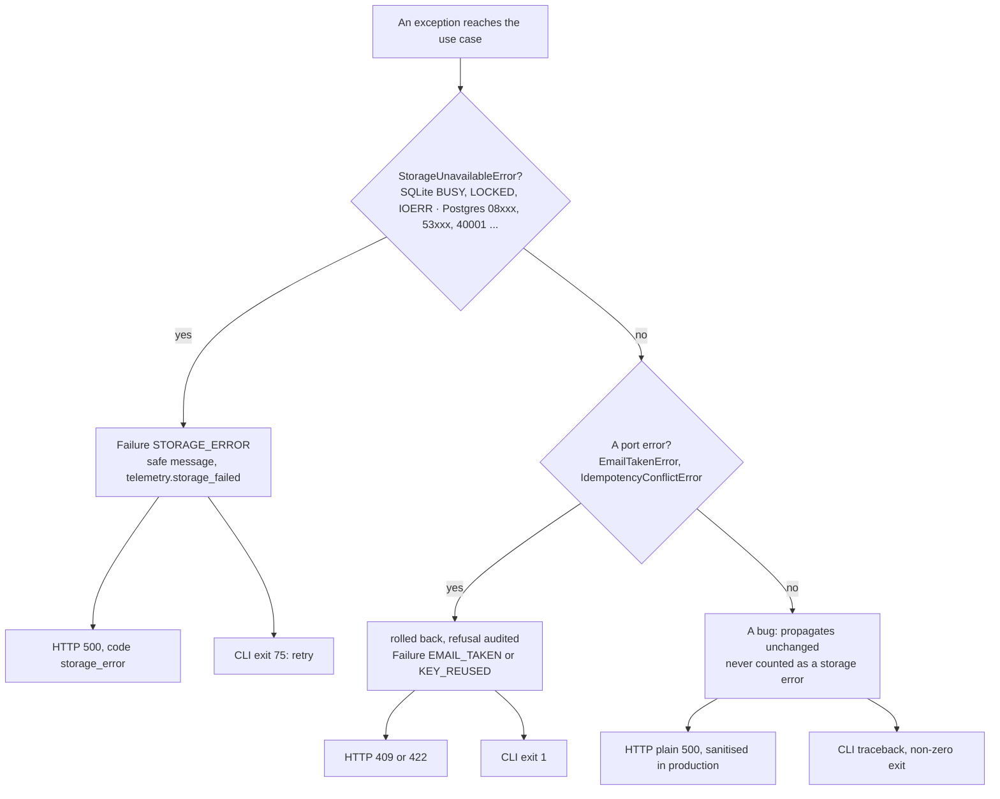

# Design decisions

Why `examples/todo` works the way it does. Structure is in [architecture.md](architecture.md).

## Consistency: unit of work + transactional outbox

A use case's writes (entities, audit entry, idempotency record) share one transaction, and
side effects that can't join it come strictly afterwards:

| Side effect | When | If it fails |
| --- | --- | --- |
| Audit entry | In the transaction, as an outbox row | The whole change rolls back. Nothing is half-done. |
| Delivery to the audit backend | Later, by `OutboxRelay` | The entry stays in the outbox and is retried. The request is unaffected. |
| Metrics and logs | After the commit, through the telemetry port | Swallowed and logged. The port's contract says it must not raise. |

Delivery is at least once. A crash right after the backend accepted an entry can repeat it, and
`metadata["audit_id"]` identifies the duplicate. A refused request (`email_taken`, a reused
key) rolls back and is then audited in its own small unit of work.

`todo_tests/integration/test_audit.py::test_audit_outage_neither_fails_nor_loses_a_registration`
is the regression test. Before this design, an audit failure returned `500` *after* the commit:
the account existed but its token was lost.

## Idempotency: safe retries

POST endpoints accept an `Idempotency-Key` header: a random value, 8–255 printable characters.
- **Retrying with the same key and body within 24 hours** returns the original result with
  `Idempotent-Replayed: true`. The same key with a different body is refused with `422`.
- **Keys are scoped:** todos per owner, so one user's key can never replay another user's todo.
- **The record is written in the same transaction as the change,** so a request that times out
  after committing (for example a 504 from blitz's timeout middleware) is safe to retry.

Registration can't return the original token on a retry, because only its hash was stored. A
retried registration therefore issues a fresh token and revokes the undelivered one, so
exactly one token from that registration is valid. The key works like a short-lived secret:
generate it randomly (a UUIDv4) and never reuse it.

## Error rules: outages vs bugs

- **Outages.** `persistence/errors.py` translates the codes that mean "can't serve this right
  now" into `StorageUnavailableError`: SQLite *result codes* (BUSY, LOCKED, IOERR, FULL, ...),
  Postgres *SQLSTATEs* (connection exceptions `08`, resources `53`, shutdown `57P`, lock and
  statement timeouts, serialization failures and deadlocks), and connect or pool timeouts.
  That `StorageUnavailableError`, which is the only exception
  use cases catch (→ `500 storage_error`).
- **Constraint violations** propagate to the repository, which translates the ones it knows
  (`EmailTakenError`).
- **Bugs.** Everything else, including SQL syntax errors and a `TypeError` in an adapter,
  propagates to blitz's unhandled-error handler as a plain 500. It is never counted or audited as
  "storage". Tests cover each path.
- **Messages.** Use-case error messages are fixed, safe strings. Raw driver text goes to logs
  only, never into responses or audit entries.

## Persistence: SQLAlchemy, Alembic, Postgres or SQLite

- **SQLAlchemy Core (async)**, not the ORM: the repositories map rows to the framework-free
  entities explicitly. Swapping the database is a matter of `TODO_DATABASE_URL`, and the
  contract tests run on both.
- **`Database.transaction()`** is one database transaction on its own pooled connection,
  committed when the block completes and rolled back when it raises or is cancelled (blitz's
  request timeout). Read-only units of work always end in `ROLLBACK`; on Postgres they are also
  `READ ONLY`.
- **SQLite:** writes take the write lock up front (`BEGIN IMMEDIATE`), so two connections can't
  deadlock upgrading read locks. Connections use WAL mode and foreign keys.
- **Postgres:** `pool_pre_ping` replaces connections the server dropped, and
  `TODO_DB_CONNECT_TIMEOUT_SECONDS` bounds every connection attempt and pool wait, so an
  unreachable database fails fast instead of hanging each request.
- **Timestamps** are stored in UTC and always read back timezone-aware (`UtcDateTime`).
- **Migrations:** each context has its own Alembic environment and version table
  (`alembic_version_users`, `alembic_version_todos`), so they evolve independently.
  - **Startup:** with `TODO_DB_MIGRATE_ON_STARTUP=true` (development) the app migrates itself.
    In production, set it to false and run `todo db upgrade` as a release step. Startup then
    refuses to run against a schema that isn't at head (CLI exit `78`).
  - **New revision:** `uv run alembic -c todo_app/users/adapters/migrations/alembic.ini revision
    --autogenerate -m "…"`.
  - **Drift test:** `todo_tests/integration/test_migrations.py` fails if the migrations and
    `sql_tables.py` drift apart, and checks that every history downgrades and upgrades cleanly.

## API tokens

- 256 random bits with a `tdo_` prefix, so secret scanners can recognise leaked tokens.
- Stored as a SHA-256 hash in their own table, so a user can hold several.
- A fast hash is safe because tokens are high-entropy, unlike passwords.
- Emails and tokens never appear in logs, audit entries or `422` details (tests assert this).
- A storage outage during authentication returns `500`, never `401`.

## One file, a connection per context

Each context opens and closes its own `Database` and owns its own tables, outbox and idempotency
store, so either context could move to its own database. `aclose()` drains its outbox before
closing the connection.

## Known trade-offs

- **Account enumeration.** `409 email_taken` on the public registration endpoint reveals
  whether an email is registered, and only the global rate limit slows probing. The real fix is
  an email-verification flow (always `202`, details sent by email), which is beyond a
  create-only example.
- **Storage outages aren't audited.** The outbox is in the storage that failed. They are logged
  and counted (`todoapp_users_storage_failures_total`, `todoapp_todos_created_total{result="error"}`).
- **Integrity sequence gaps.** `SequenceIntegrity` numbers events as they're delivered, so an
  entry whose delivery failed gets a new number when it's retried.
- **SQLite is for local runs.** Writes are serialised, and with `WORKERS > 1` processes contend
  for the file lock: a write that can't get it within `TODO_DB_BUSY_TIMEOUT_MS` becomes a
  `storage_error`. Use Postgres anywhere else.
- **Several app instances relay the same outbox** without claiming rows, so an entry can be
  delivered twice (identified by `audit_id`). `FOR UPDATE SKIP LOCKED` claiming is the next step.
- **Housekeeping.** Expired idempotency records are overwritten when their key is reused, but
  never purged.
